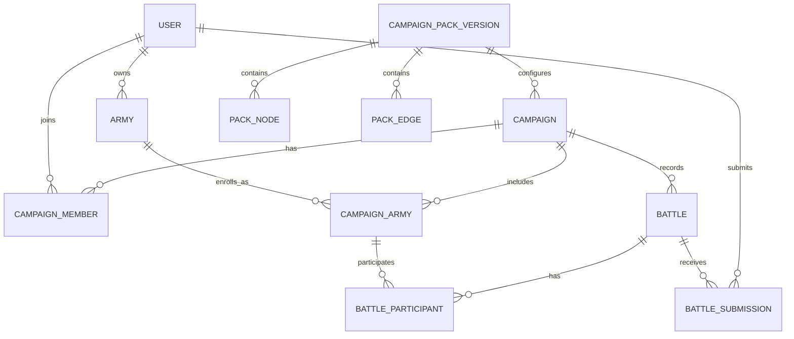

# Age of Sigmar Campaign Tracker - Project Plan

## 1. Product goal

Build a small, friends-only web application where:

1. A user signs in with Google.
2. A user creates one or more reusable armies using all fields represented on the supplied Path to Glory roster.
3. A user creates a campaign from a versioned campaign pack.
4. Another user joins with an invite code and enrolls an army.
5. The players record battles, scores, and results.
6. Each enrolled army advances through the campaign pack's mission graph according to configured transition rules.
7. Players can review the roster, campaign position, battles, and audit history.

This plan treats the supplied PDFs as reference material. The site should use an original interface and should not publish the PDFs, scanned page artwork, or large copied passages.

## 2. Recommended architecture

```text
GitHub public repository
  -> GitHub Actions
     -> GitHub Pages (static React application)

Browser
  -> Firebase Authentication (Google sign-in)
  -> Firebase ID token in Authorization header
  -> Cloud Run TypeScript API
     -> verifies Firebase ID token
     -> checks campaign membership/role
     -> reads and writes Firestore with a dedicated service account
```

### Why this stack

- **Vite + React + TypeScript:** fast to build, easy static deployment, and suitable for forms plus an interactive campaign graph.
- **Cloud Run:** keeps authorization, battle resolution, invite handling, and campaign transitions out of the public browser bundle.
- **Firestore:** campaign state is document-shaped, small, and query-oriented. It avoids operating a SQL server for a two-player personal project while still supporting transactions for battle confirmation and progression.
- **Firebase Authentication:** provides Google sign-in and browser ID tokens that the API can verify.

The Cloud Run service is reachable from the browser, so it is deployed with public network invocation. Every application endpoint except health checks and CORS preflight must verify the Firebase ID token. Firestore is not called directly by the browser in the first version.

### Privacy boundary

The repository and GitHub Pages site are intentionally public. The application data remains friends-only. Therefore:

- assume the complete source repository, HTML, CSS, JavaScript bundle, and Firebase client configuration are public;
- place no secrets, private documents, or service-account keys in the frontend;
- allow only the exact production Pages origin and local development origin in API CORS configuration;
- authorize every data request in the API by authenticated user ID and campaign membership;
- add the production Pages domain to Firebase Authentication's authorized domains;
- keep all campaign and roster records in Firestore behind the API.

The existing Google Cloud project will be connected during implementation. Its project ID belongs in local/deployment configuration, while credentials and service-account keys must never be committed.

## 3. Domain model

The important distinction is between an **army** and an **army enrolled in a campaign**. The army owns its reusable roster. The enrollment owns campaign-specific position, score, and history. This makes one army usable in many campaigns without ambiguous campaign state.



### Firestore collections

Use small top-level collections and explicit reference IDs. This keeps common queries simple and avoids large arrays inside campaign documents.

| Collection | Purpose | Important fields |
| --- | --- | --- |
| `users` | App profile keyed by Firebase UID | `displayName`, `email`, `photoUrl`, `createdAt`, `lastSeenAt` |
| `armies` | Reusable army and roster header | `ownerUid`, `name`, `realmOfOrigin`, `faction`, `battleFormation`, `gloryPoints`, roster fields, timestamps |
| `armyUnits` | Warlord and repeating unit entries | `armyId`, `kind`, `sortOrder`, warscroll and progression fields |
| `armyRevisions` | Immutable roster snapshots | `armyId`, `createdByUid`, `snapshot`, `reason`, `createdAt` |
| `campaignPacks` | Stable pack identity | `slug`, `name`, `description`, `activeVersionId` |
| `campaignPackVersions` | Immutable rules/graph version | `campaignPackId`, `version`, `status`, `createdAt` |
| `packNodes` | Battleplan nodes | `packVersionId`, `key`, `name`, `tier`, display coordinates |
| `packEdges` | Typed directed transitions | `packVersionId`, `fromNodeKey`, `toNodeKey`, `pathType`, `trigger`, `bidirectional`, `enabled` |
| `campaigns` | A played instance of one pack version | `name`, `ownerUid`, `packVersionId`, `status`, `progressionMode`, `createdAt` |
| `campaignMembers` | User-to-campaign join record | `campaignId`, `uid`, `role`, `status`, `joinedAt` |
| `campaignInvites` | Join codes stored as hashes | `campaignId`, `codeHash`, `expiresAt`, `maxUses`, `uses`, `revokedAt` |
| `campaignArmies` | Army-to-campaign enrollment | `campaignId`, `armyId`, `ownerUid`, `currentNodeKey`, `completedNodeKeys`, `campaignPoints`, `wins`, `losses`, `draws` |
| `battles` | One campaign battle | `campaignId`, `nodeKey`, `status`, `playedAt`, `createdByUid`, `resolvedAt` |
| `battleParticipants` | Army result in a battle | `battleId`, `campaignArmyId`, `score`, `outcome`, `previousNodeKey`, `nextNodeKey` |
| `battleSubmissions` | Each player's attestation | `battleId`, `submittedByUid`, `scores`, `outcomes`, `notes`, `submittedAt` |
| `auditEvents` | Append-only important changes | actor, entity, action, safe metadata, timestamp |

All records include `schemaVersion`, `createdAt`, and `updatedAt` where applicable. IDs are opaque Firestore IDs except `users/{uid}`. Invite codes are never stored in plaintext after creation.

### Roster fields from the supplied pages

The army editor should cover every visible field while allowing free-form text.

#### Army header and journal

- Heraldry image or description
- Army name
- Realm of origin
- Glory points
- Faction
- Battle formation
- Current quest
- Quest points
- Quest notes
- Quests completed
- Background
- Notable events
- Arcane Tome: up to six entries each for spell lore, prayer lore, and manifestation lore

#### Order of battle

- Warlord: name, warscroll, rank, renown, enhancements, path, and path abilities
- Repeating unit: unit name, warscroll, rank, renown, enhancements, path abilities, and reinforced flag

Enhancements and path abilities should be stored as ordered string arrays even though the first UI can present simple add/remove free-form rows.

#### Blighted Wilds extensions

- Landmark of Ghyran: name, size, curator flag, points, total DP, DP spent, form, origin, flaw, move, save, health, control, abilities/upgrades, keywords, and faction terrain
- Regiment of Ghyran: name, origin, flaw, regiment size, points, total DP, DP spent, and idiosyncrasies
- Regiment hero: warscroll name, archetype, path, rank, DP cost, upgrades, battle mount, battle wounds, battle scars, and renown points
- Up to three regiment units with the same fields except archetype

These extensions belong to an army as optional typed modules, not to every campaign pack globally.

## 4. Blighted Wilds campaign pack seed

The supplied battleplan map contains 12 mission nodes across six visual tiers:

| Tier | Nodes |
| --- | --- |
| 1 | Thyria's Bounty; Forest Fortress |
| 2 | A Dense and Choking Maze; Cursed Kernel; Escort to the Wellspring Grove |
| 3 | Nexuses of Contamination; Precarious Crossing |
| 4 | Emergency Foraging; The Call of Sacrifice |
| 5 | Vital Alignment; Creeping Rootstalks |
| 6 | Be It Purity or Putrescence |

The visually represented directed routes to seed are:

| From | To | Path type |
| --- | --- | --- |
| Thyria's Bounty | A Dense and Choking Maze | Thyrian |
| Thyria's Bounty | Cursed Kernel | Thyrian |
| Forest Fortress | Cursed Kernel | Thyrian |
| Forest Fortress | Escort to the Wellspring Grove | Thyrian |
| A Dense and Choking Maze | Nexuses of Contamination | Thyrian |
| Cursed Kernel | Nexuses of Contamination | Concealed |
| Cursed Kernel | Precarious Crossing | Concealed |
| Escort to the Wellspring Grove | Precarious Crossing | Thyrian |
| Nexuses of Contamination | Precarious Crossing | Thyrian, both directions |
| Nexuses of Contamination | Emergency Foraging | Thyrian |
| Nexuses of Contamination | The Call of Sacrifice | Thyrian |
| Precarious Crossing | Emergency Foraging | Thyrian |
| Precarious Crossing | The Call of Sacrifice | Thyrian |
| Emergency Foraging | The Call of Sacrifice | Thyrian, both directions |
| Emergency Foraging | Vital Alignment | Thyrian |
| The Call of Sacrifice | Creeping Rootstalks | Thyrian |
| Vital Alignment | Creeping Rootstalks | Thyrian, both directions |
| Vital Alignment | Be It Purity or Putrescence | Concealed |
| Creeping Rootstalks | Be It Purity or Putrescence | Concealed |

Edges have a `pathType` of `thyrian` or `concealed`. The visual map supplies connectivity, but it does **not** define which route represents a victory, defeat, draw, or player choice. Therefore:

- seed node names, layout positions, and visually represented path types;
- keep each edge's `trigger` configurable (`victory`, `defeat`, `draw`, `choice`, or `manual`);
- do not auto-advance from a battle until the relevant campaign-pack rules establish the trigger mapping;
- allow a campaign owner to select a valid next node manually as the safe MVP fallback.

Campaigns reference an immutable `campaignPackVersion`. Correcting or expanding a pack creates a new version and does not silently change campaigns already in progress.

## 5. User experience and routes

### Public shell

- `/` - short product intro and Google sign-in
- `/auth/callback` - sign-in completion/error state if the selected Firebase flow needs it

### Authenticated application

- `/dashboard` - my armies, active campaigns, invitations, and recent battles
- `/armies/new` - guided free-form roster editor
- `/armies/:armyId` - roster view
- `/armies/:armyId/edit` - roster editor with autosaved draft and explicit save
- `/campaigns/new` - choose pack, name campaign, choose starting node/progression options
- `/join/:code` - accept campaign invite
- `/campaigns/:campaignId` - campaign map, enrolled armies, current positions, and battle history
- `/campaigns/:campaignId/battles/new` - record a battle from an allowed node
- `/battles/:battleId` - submissions, confirmation state, result, scores, notes, and resulting movement

The campaign map should be a responsive SVG/HTML graph using original styling. Node state is visually distinct: locked, available, current, completed, and selected. Keyboard users must be able to focus and activate every available node.

## 6. Core workflows

### Google sign-in

1. The browser signs in with Firebase Authentication's Google provider.
2. The browser requests a fresh Firebase ID token.
3. API calls send `Authorization: Bearer <token>`.
4. Cloud Run verifies the token with the Firebase Admin SDK and uses the decoded `uid` as the only user identity.
5. The API creates or updates the safe `users` profile.

Never trust a UID, email, role, owner ID, or membership supplied only in the request body.

### Campaign join

1. Owner creates an expiring invite code.
2. API stores only its hash and returns the plaintext code once.
3. Friend signs in, opens the invite route, and accepts.
4. A transaction validates expiry/use count and creates the `campaignMembers` record.
5. The new member enrolls an owned army.

### Battle submission and confirmation

1. Either player creates a draft battle for an available node.
2. Each participant submits that player's view of scores, outcome, and optional notes.
3. If the submissions agree, either participant can confirm; if they differ, the battle becomes `disputed` and nothing advances.
4. A Firestore transaction rechecks membership, current positions, allowed edges, and battle status.
5. The transaction resolves the battle, writes participant results, updates campaign-army statistics/positions, and appends audit events atomically.
6. Resolution is idempotent: retrying the same confirmation cannot apply points or movement twice.

### Progression modes

Support the data shape for both, but implement `per-army` first:

- `per-army`: each enrolled army has its own current node and advances from its own result;
- `shared`: the campaign has one current node and the group advances together.

## 7. API outline

All routes except `/healthz` require a valid Firebase ID token.

```text
GET    /api/me
GET    /api/armies
POST   /api/armies
GET    /api/armies/:armyId
PATCH  /api/armies/:armyId
POST   /api/armies/:armyId/revisions

GET    /api/campaign-packs
GET    /api/campaign-packs/:packVersionId/graph

GET    /api/campaigns
POST   /api/campaigns
GET    /api/campaigns/:campaignId
POST   /api/campaigns/:campaignId/invites
POST   /api/invites/:code/accept
POST   /api/campaigns/:campaignId/armies

POST   /api/campaigns/:campaignId/battles
GET    /api/battles/:battleId
PUT    /api/battles/:battleId/submission
POST   /api/battles/:battleId/confirm
```

Validate all request and response payloads with shared schemas. Recommended implementation: `zod` in a shared package.

## 8. Repository layout

```text
.
├── apps/
│   ├── web/                 # React/Vite static application
│   └── api/                 # TypeScript Cloud Run service
├── packages/
│   └── shared/              # schemas, DTOs, domain enums, graph helpers
├── seed/
│   └── campaign-packs/      # reviewed, versioned pack data
├── infra/
│   ├── cloudbuild/          # optional API deployment config
│   └── scripts/             # idempotent project/bootstrap/deploy helpers
├── docs/
├── .github/workflows/
│   ├── ci.yml
│   └── deploy-pages.yml
└── package.json             # pnpm workspace
```

Use the already-created Google Cloud project for development initially. The owner will authenticate locally with `gcloud` when deployment work begins. Before inviting friends, create separate development and production Firebase/Google Cloud projects, or at minimum separate Firestore databases and environment configurations.

## 9. Security baseline

- Firebase Google sign-in only for MVP.
- Optional email allowlist or owner-approved membership before a new account can create/join campaigns.
- Cloud Run runtime service account with only the Firestore permissions it needs.
- No downloaded service-account JSON keys; use Application Default Credentials locally and workload identity in deployment.
- Exact-origin CORS allowlist; reject arbitrary origins.
- Firestore client access denied because the browser uses the API.
- Server-side validation for field lengths, numbers, enum values, ownership, membership, and state transitions.
- Rate limits for invite acceptance, battle creation, and write endpoints.
- Invite codes are random, expiring, revocable, use-limited, and stored hashed.
- Append-only audit trail for campaign membership, battle resolution, progression, and roster snapshot references.
- Original UI assets only; do not commit or deploy the supplied PDFs.

## 10. Delivery phases

### Phase 0 - Foundation

- Initialize pnpm monorepo, TypeScript, formatting, tests, and shared schemas.
- Create Firebase/Google Cloud project configuration templates.
- Add Vite base-path handling for a GitHub project Pages URL.
- Add CI and GitHub Pages deployment workflow.
- Add Cloud Run API container and `/healthz`.
- Add local Firebase emulator configuration.

**Exit:** web and API run locally; CI builds both; static shell deploys without secrets.

### Phase 1 - Authentication and authorization

- Add Google sign-in/out and auth state handling.
- Verify Firebase ID tokens in the API.
- Create user profiles and membership authorization helpers.
- Add exact-origin CORS and environment validation.

**Exit:** two Google accounts can sign in; anonymous requests cannot read application data.

### Phase 2 - Complete free-form army roster

- Build army list, create, view, and edit screens.
- Implement every roster field listed in section 3.
- Add repeating units and optional Blighted Wilds modules.
- Create immutable roster revisions on explicit save.

**Exit:** each player can create and later edit a complete roster without losing any represented field.

### Phase 3 - Campaigns and pack graph

- Seed the versioned Blighted Wilds nodes and reviewed edges.
- Create campaign, invite, join, and army-enrollment flows.
- Render the campaign graph with accessible node states.
- Track each enrolled army's current and completed nodes.

**Exit:** player A creates a campaign, player B joins, and both attach an army and see the same graph/state.

### Phase 4 - Battles and progression

- Add draft battle, two-sided submissions, confirmation, and dispute handling.
- Record victory/defeat/draw, player points, and notes.
- Resolve battle plus campaign movement in one idempotent transaction.
- Use manual selection among valid outgoing edges until result triggers are supplied and verified.

**Exit:** a confirmed battle updates history, statistics, and both campaign-army positions exactly once.

### Phase 5 - Hardening and polish

- Emulator-backed authorization and transaction tests.
- Mobile/responsive and keyboard-accessibility pass.
- Error recovery, loading/empty states, audit history, export/backup.
- Production project, budgets/alerts, logging, deployment runbook, and friend onboarding.

**Exit:** the two-player end-to-end acceptance scenario is reliable in production.

## 11. First playable slice acceptance test

The MVP is complete when this exact scenario passes:

1. Player One signs in with Google and creates Army One with header, journal, Arcane Tome, warlord, and at least two units.
2. Player Two signs in independently and creates Army Two with the same available field coverage.
3. Player One creates a Blighted Wilds campaign and receives a time-limited invite link.
4. Player Two accepts the invitation.
5. Both players enroll their armies and can see the 12-node campaign map.
6. They create a battle at an allowed starting/current node.
7. Both submit matching points and outcomes.
8. Confirmation resolves the battle once, records victory/defeat and points, snapshots the relevant rosters, and moves each army to an allowed next node (manual edge choice until rules are known).
9. Refreshing, signing out/in, or retrying confirmation does not lose data or double-apply the result.
10. A third authenticated but non-member account cannot read or mutate the campaign.

## 12. Decisions still needed

These do not block Phases 0-3:

1. Supply the campaign-pack rules that map battle results to specific outgoing paths. The map page alone is not sufficient.
2. Confirm whether an army's roster/progression is globally shared across all campaigns or can fork per campaign. The proposed revision model supports either; MVP assumes a shared roster with campaign-specific position and statistics.
3. Confirm whether a campaign starts at either top-tier node by owner choice, random choice, or another pack rule.
4. Decide whether account access is open to any Google account with an invite or restricted by an owner-managed email allowlist. Recommended MVP: invite plus allowlist.
5. Decide whether one player may confirm matching submissions or whether both must explicitly confirm. Recommended MVP: both submit, then either can confirm an exact match.

## 13. Implementation references

- [GitHub Pages custom workflows](https://docs.github.com/en/pages/getting-started-with-github-pages/using-custom-workflows-with-github-pages)
- [GitHub Pages site visibility](https://docs.github.com/en/enterprise-cloud@latest/pages/getting-started-with-github-pages/changing-the-visibility-of-your-github-pages-site)
- [Firebase Authentication for web](https://firebase.google.com/docs/auth/web/start)
- [Cloud Run end-user authentication](https://docs.cloud.google.com/run/docs/authenticating/end-users)
- [Cloud Firestore data model](https://firebase.google.com/docs/firestore/data-model)
- [Cloud Firestore transactions](https://firebase.google.com/docs/firestore/manage-data/transactions)
- [Firebase security checklist](https://firebase.google.com/support/guides/security-checklist)
